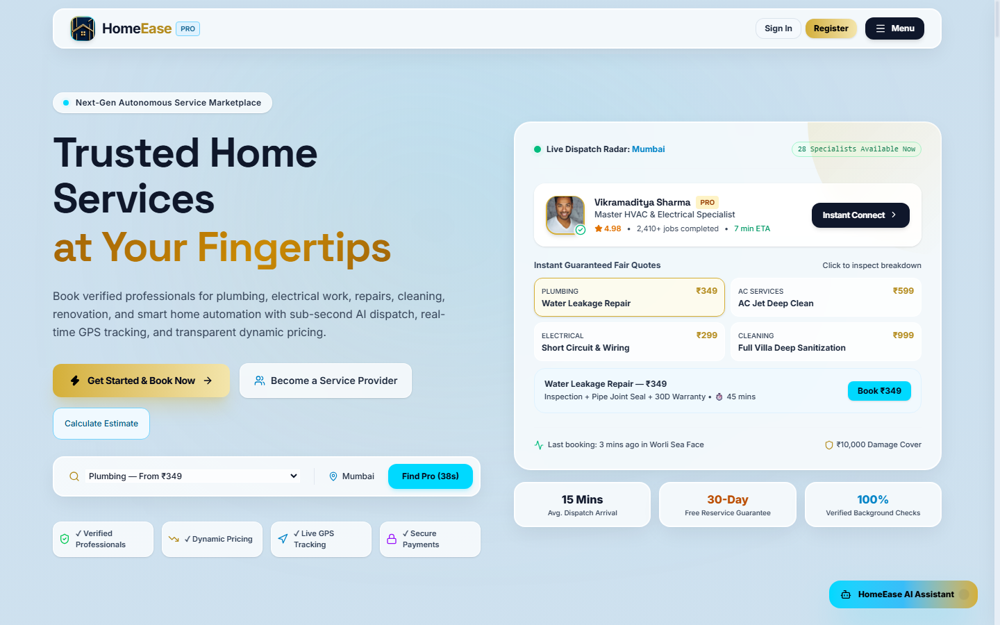
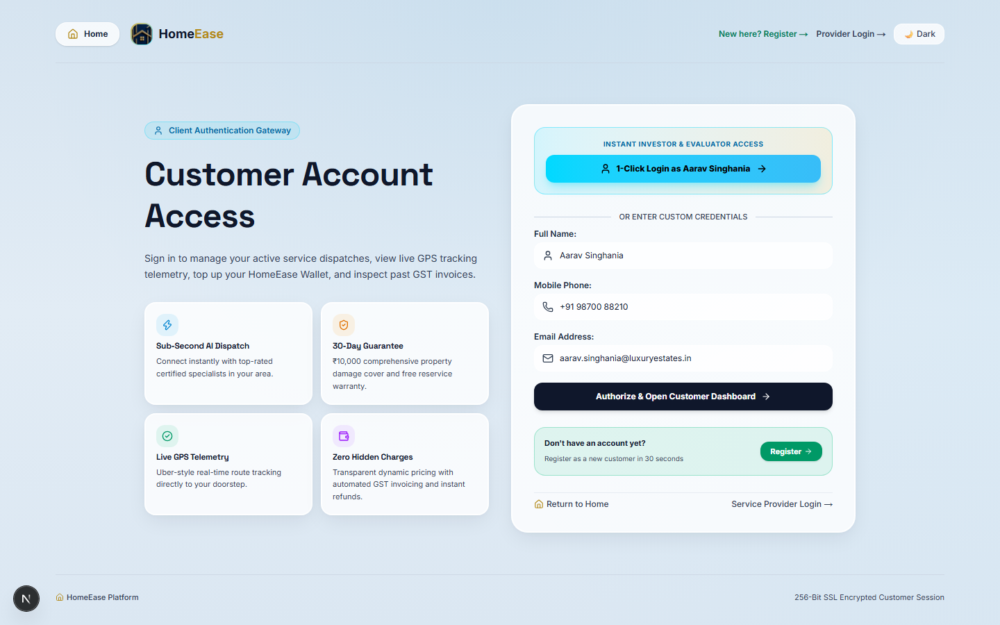
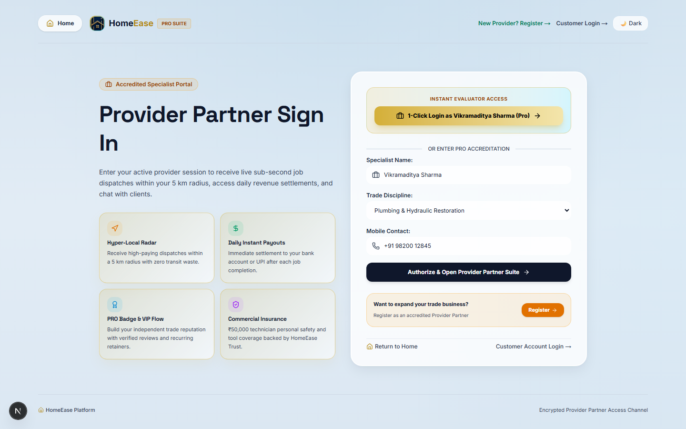
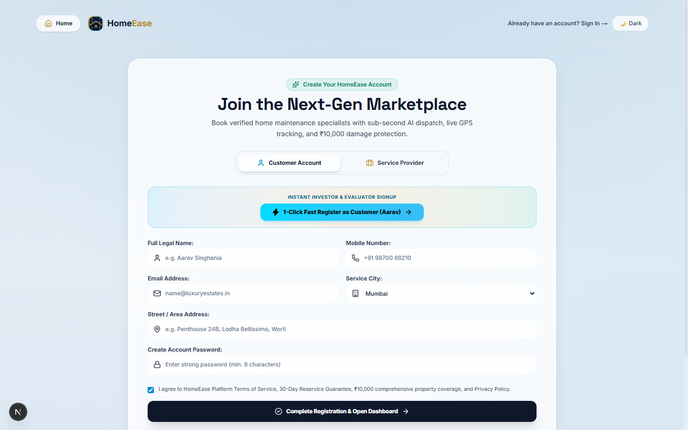
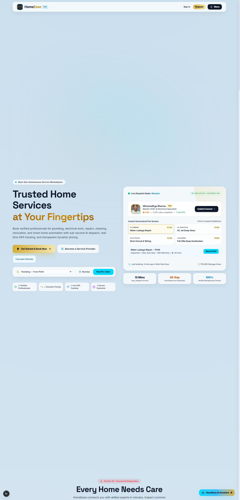

<div align="center">


# HomeEase — Premium 3D Home Services Marketplace

**Autonomous, Next-Generation On-Demand Home Services with Continuous 3D Architectural Choreography, Uber-Style Live GPS Dispatch, Tiered Customer Loyalty & Split-Wallet Architecture.**

[](https://nextjs.org/)
[](https://react.dev/)
[](https://www.typescriptlang.org/)
[](https://tailwindcss.com/)
[](https://threejs.org/)
[](https://bun.sh/)

[Key Features](#-key-features) • [Step-by-Step Walkthrough](#-step-by-step-visual-walkthrough) • [Tech Stack](#-technology-stack) • [Quick Start](#-quick-start) • [Deployment](#-deployment-to-github--vercel)

---

</div>

## 🌟 Overview

**HomeEase** is a luxury on-demand home service marketplace connecting homeowners with verified, background-checked master technicians across 14 service verticals. Built with modern web standards and luxury glassmorphism design, HomeEase provides transparent upfront pricing, dynamic surge intelligence, real-time GPS dispatch simulation, multi-tiered loyalty bonuses, split-wallet accounting (real cash + promotional credits), and interactive 3D spatial room diagnostics.

---

## ⚡ Key Features

- **Continuous 3D Villa Scroll Canvas**: Interactive Three.js WebGL choreography transitioning seamlessly between whole-house wiring, luxury living room, modular kitchen, and modern bathroom as you scroll.
- **14 Verified Service Verticals**: Instant bookings for plumbing, electrical, AC repair, deep cleaning, smart home automation, pest control, painting, and luxury renovation.
- **Uber-Style Live GPS Tracking**: Simulated sub-second technician dispatch with real-time ETA, route pathing, speed telemetry, and contact hotline.
- **Split Wallet & Loyalty Rewards**:
  - Main balance (100% redeemable) + Promotional bonus balance.
  - 10% maximum bonus redemption cap per booking.
  - ₹200 welcome voucher applied across the first 5 bookings.
  - Tiered top-up bonuses (up to 20% instant credit bonuses on ₹5,000+ deposits).
  - Four Loyalty Tiers: **Regular**, **Silver** (VIP), **Gold**, and **Platinum Elite**.
- **Universal Google Pay & UPI QR Integration**: One-click UPI payments and high-resolution QR payment modal for subscriptions and emergency technician bookings.
- **Multi-Role Portal Suite**:
  - **Client Portal**: Profile management, booking history, wallet statements, referral links.
  - **Service Provider Suite**: Technician verification, dispatch queue, earning analytics.
  - **Administrator Console**: Platform health, provider KYC verification, financial ledger.

---

## 📸 Step-by-Step Visual Walkthrough

### Step 1: Luxury Landing Experience & Instant AI Estimator
*Dynamic 3D spatial hero, live professional status monitor, and one-tap quick service estimator.*


---

### Step 2: Customer Account Gateway & Split Wallet
*Client authentication gateway featuring active loyalty badges, real-time wallet balances, and account summaries.*


---

### Step 3: Service Provider Partner Suite
*Technician onboarding and dispatch portal with verified professional verification guidelines.*


---

### Step 4: Unified Registration Gateway
*Dual-track registration system allowing instant signup for either homeowners or certified service contractors.*


---

### Step 5: Full Architectural Showcase
*Comprehensive platform showcasing service catalog, 3D interactive breakdowns, testimonials, and dynamic pricing tiers.*


---

## 🛠 Technology Stack

| Category | Tools & Libraries |
| :--- | :--- |
| **Framework** | [Next.js 16.4.3](https://nextjs.org/) (App Router & Turbopack) |
| **UI Library** | [React 19.3.0](https://react.dev/) |
| **3D Graphics** | [Three.js 0.186](https://threejs.org/), [@react-three/fiber 9.8](https://docs.pmnd.rs/react-three-fiber), [@react-three/drei 10.7](https://github.com/pmndrs/drei) |
| **Styling** | [Tailwind CSS 4](https://tailwindcss.com/) with Turbopack CSS rules |
| **Motion & FX** | [Framer Motion 14.7](https://www.framer.com/motion/), [GSAP 3.15](https://greensock.com/gsap/), Canvas-Confetti |
| **Icons** | [Lucide React](https://lucide.dev/) |
| **Runtime & Tests** | [Bun 1.3.9](https://bun.sh/) & Node.js 24 |

---

## 🚀 Quick Start

### 1. Prerequisites
- **Node.js** v20+ or **Bun** v1.2+
- **Git**

### 2. Clone Repository
```bash
git clone https://github.com/Ohm1101/homeease.git
cd homeease
```

### 3. Install Dependencies
```bash
bun install
# or
npm install
```

### 4. Run Development Server
```bash
bun run dev
# or
npm run dev
```

Open [http://localhost:3000](http://localhost:3000) in your web browser.

---

## 🧪 Testing & Quality Assurance

HomeEase includes end-to-end customer lifecycle integration tests and automated linting:

```bash
# Run unit & lifecycle integration tests (11 passing tests)
bun test

# Run ESLint validation
bun run lint

# Compile production build with Turbopack
bun run build
```

---

## 📦 Project Directory Structure

```text
homeease/
├── docs/
│   └── screenshots/              # High-resolution step-by-step visual captures
├── public/
│   ├── images/
│   │   ├── homeease-icon.png     # 512x512 Master Gold 3D Emblem
│   │   ├── homeease-full-logo.png# Full horizontal brand emblem with typography
│   │   ├── homeease-badge.jpg    # High-resolution leather-embossed badge
│   │   └── subscription-qr.jpg   # Google Pay & UPI Payment QR
│   ├── screenshots/              # Live deployment image assets
│   ├── favicon.ico               # Browser tab icon
│   └── modern_villa_complete_with_interiors.glb # 3D Villa GLTF model
├── src/
│   ├── app/                      # Next.js App Router (Layouts & Pages)
│   │   ├── customer/login/       # Customer authentication portal
│   │   ├── provider/login/       # Service provider portal
│   │   ├── register/             # Unified account registration
│   │   ├── icon.png              # App Router responsive tab icon
│   │   ├── apple-icon.png        # Apple touch icon
│   │   ├── layout.tsx            # Global metadata, fonts, theme context
│   │   └── page.tsx              # Main marketplace single-page app
│   ├── components/
│   │   ├── 3d/                   # Three.js Background canvas & room models
│   │   ├── dashboards/           # Customer, Provider & Admin functional dashboards
│   │   ├── layout/               # Navbar & Footer with brand badge
│   │   ├── modals/               # Booking, dynamic pricing, UPI QR & auth modals
│   │   └── sections/             # Hero, Services, Tracking, Reviews, Pricing, CTA
│   ├── context/
│   │   └── AppContext.tsx        # Global state, split wallet, cart & personas
│   ├── data/                     # Mock data, service pricing, and scene configurations
│   ├── tests/                    # E2E lifecycle and wallet tests
│   └── utils/                    # Tier calculations & pricing rules
├── eslint.config.mjs             # ESLint configuration
├── next.config.ts                # Turbopack & remote image patterns
└── package.json
```

---

## 🚢 Deployment to GitHub & Vercel

### Step 1: Create a GitHub Repository
1. Go to [GitHub New Repository](https://github.com/new).
2. Name the repository: `homeease`.
3. Choose **Public** or **Private**.
4. Leave "Initialize this repository with a README" **unchecked** (we already have this complete repository).

### Step 2: Push to GitHub
Run the following commands in your terminal from the `C:\Users\ohmt3\homeease` folder:

```bash
# Add your GitHub repository as origin (replace Ohm1101 if using another account)
git remote add origin https://github.com/Ohm1101/homeease.git

# Set branch to main or master
git branch -M master

# Push all files, assets, and history
git push -u origin master
```

### Step 3: Deploy to Vercel (Instant)
1. Import your newly created `homeease` repository on [Vercel](https://vercel.com/new).
2. Framework Preset will auto-detect **Next.js**.
3. Click **Deploy**. Your site will be live on a custom `.vercel.app` domain with SSL, global CDN, and automatic CI/CD deployments!

---

<div align="center">

Made with ❤️ by [HomeEase Global](https://homeease.app)

</div>
